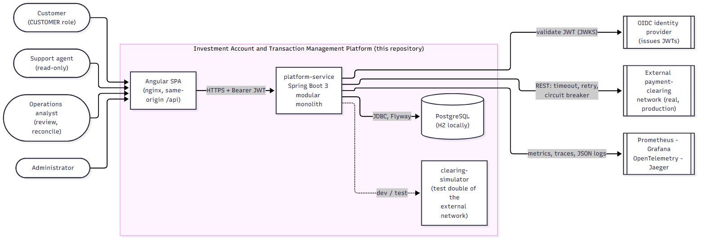
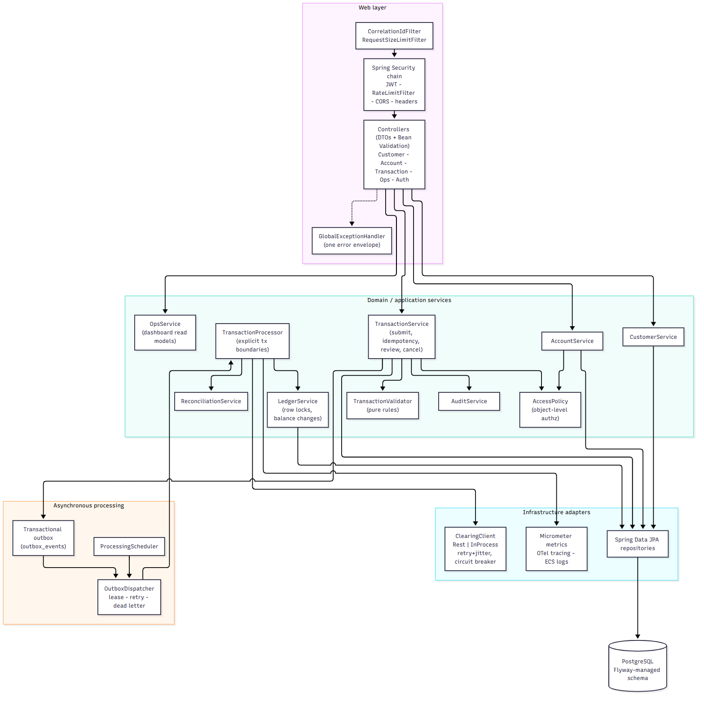

# System context and component architecture

## System context

The platform exposes one REST API (`/api/v1`) consumed by an Angular single-page application. Staff and customers authenticate
against an OIDC identity provider; the API validates the JWT. Money movements that leave the platform (withdrawals) call an
external **clearing network** over REST. In development and tests that network is replaced by the `clearing-simulator`, a small
Spring Boot service with deterministic and chaos behaviours; if no clearing URL is configured at all, an in-process
approve-everything substitute is used so the application runs stand-alone.

## Decision: modular monolith, not microservices

The assignment asks for a modular architecture and says to introduce separate deployable services *only when the separation
provides meaningful benefits*. The decision (full text: ADR-001):

**Chosen:** one Spring Boot deployable (`platform-service`) with clear internal modules - `customer`, `account`, `transaction`
(ledger, processing, reconciliation, outbox), `audit`, `ops`, `security`, `clearing`, `common` - plus one small second service
(`clearing-simulator`) that exists because it stands in for a genuinely separate system.

**Why:**

| Concern | Modular monolith | Microservices (customer / account / transaction / audit) |
|---|---|---|
| Transfer atomicity | one local ACID transaction debits and credits | needs a saga or 2PC across services; partial failure states appear and must be compensated |
| Idempotency, ledger = balance invariant | enforced by constraints and row locks in one database | spread over several databases; invariants become eventually consistent |
| Operational cost | one pipeline, one database, one set of dashboards | N pipelines, service discovery, distributed tracing mandatory, N databases, contract tests between services |
| Team fit | one team | pays off with several teams that must release independently |
| Failure isolation | a bad deploy affects everything (mitigated by rolling updates and the async worker) | blast radius per service |
| Scaling | scale the whole unit; the DB is the bottleneck anyway | scale hot spots independently |

The *money invariants* (a balance can never differ from its ledger; a transfer is all-or-nothing) are the reason **not** to split
`account` from `transaction`: they need one transaction boundary. Splitting them would create exactly the distributed
transaction the brief warns against creating "merely to demonstrate microservices".

**Alternatives considered:** (a) microservices per module - rejected for the reasons above; (b) a modular monolith with a
separate worker deployment for the outbox dispatcher - a cheap first extraction, noted in the migration path; (c) event
sourcing - rejected as unnecessary complexity for this scope.

**Migration path (when the pressure appears):** the module boundaries are already enforced by package-level dependencies
(`account` never imports `transaction`; the `AccountClosureGuard` port inverts that dependency). Extraction order:
1. run the outbox dispatcher/processor as a separate deployment of the same artefact (`app.processing.dispatcher-enabled`);
2. move `audit` + `ops` read models behind events (they are read-mostly) into a reporting service with its own store;
3. only then consider splitting `customer` (low write rate, no money invariants);
4. keep `account` + `ledger` + `transaction` together until a measured bottleneck proves otherwise.

## Component architecture

* **Web layer** - servlet filters (correlation id, request-size limit), the Spring Security chain (JWT validation, rate limit,
  CORS, headers), thin controllers that only translate HTTP to service calls and DTOs, and one `GlobalExceptionHandler` that
  produces the standard error envelope.
* **Domain/application services** - business rules live here, not in controllers or entities' persistence annotations.
  `TransactionValidator` and `AccessPolicy` are **pure** (no I/O) so each rule is a one-line unit test.
* **Asynchronous processing** - submission validates synchronously and records an outbox event in the same database
  transaction; `OutboxDispatcher` delivers it at-least-once to `TransactionProcessor`.
* **Infrastructure adapters** - Spring Data repositories, the `ClearingClient` port (REST adapter with retry/jitter and a
  circuit breaker, plus an in-process substitute), Micrometer/OpenTelemetry.

## Data ownership

There is one database and one schema; every table is owned by exactly one module's service layer (`customers` by
`CustomerService`, `accounts` by `AccountService` and balance changes **only** through `LedgerService`, `transactions`/`ledger_entries`/
`idempotency_records`/`transaction_attempts`/`reconciliation_records`/`outbox_events` by the transaction module, `audit_events`
append-only by `AuditService`). Controllers never touch repositories directly (the one exception, the read-only audit listing,
is documented in the code).

## Communication and failure semantics

| Interaction | Style | Timeout / retry | Failure isolation |
|---|---|---|---|
| SPA -> API | HTTPS REST, JSON | browser/nginx timeouts (30 s) | error envelope with correlation id |
| API -> clearing network | REST, **idempotent on `reference`** | connect 500 ms, read 2 s, 3 attempts, exponential backoff with full jitter | circuit breaker (50 % of 10 calls) -> fast "not sent" failure + refund; unknown -> reconciliation |
| API -> DB | JDBC | Hikari: 3 s to get a connection, 5 s lock wait on account rows | bounded waits turn pile-ups into fast retryable `503 LOCK_TIMEOUT` |
| Submit -> processing | transactional outbox, in-process | claim by lease, backoff `2s * 2^n` (max 5 min), 5 attempts | dead-letter state + alert; consumer is idempotent |
| Correlation | `X-Correlation-Id` in/out, MDC, trace id | - | every log line and audit row carries it |

## Synchronous database transactions versus distributed workflows

A **database transaction** gives atomicity and isolation *inside one database*. It cannot make an HTTP call to another company
roll back. The platform therefore draws a hard line (see the transaction-boundaries diagram in the integrity chapter):

* everything that is purely about **our** data - validating, reserving funds, posting a transfer, recording a state change, writing
  the audit row and the outbox event - happens inside local ACID transactions;
* everything that involves an **external system** - the clearing authorization - happens *outside* any database transaction
  and is modelled as a small **workflow with explicit states** (`PROCESSING -> COMPLETED | FAILED | RECONCILIATION_REQUIRED`),
  idempotent calls, and a reconciliation path for the "did it happen?" case.

The platform never claims distributed exactly-once. It provides **at-least-once delivery plus idempotent consumers plus
reconciliation**, which together produce *effectively-once* effects on our own data and a *detectable, repairable* state for
the one thing we cannot control.
