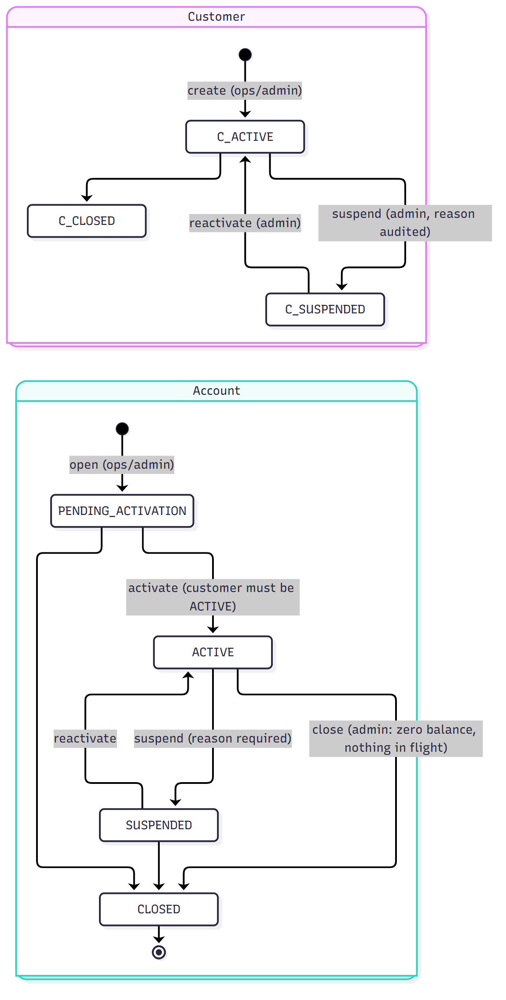
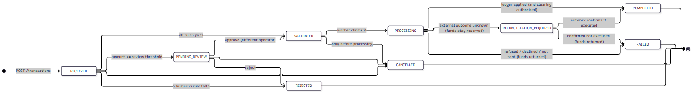

# Customer, account and transaction lifecycles

## Domain model in one paragraph

A **Customer** owns one or more **Accounts**. Money moves through **Transactions** (deposit, withdrawal, internal transfer). A
transaction posts **LedgerEntries** (immutable debit/credit lines); an account's stored balance must always equal the signed sum of
its ledger entries. Everything that matters is recorded as an **AuditEvent**. Anything that has to be delivered later is
written as an **OutboxEvent**, and anything whose external outcome is uncertain gets a **ReconciliationRecord**.

## Customer and account lifecycle

| Transition | Who | Rules enforced in code |
|---|---|---|
| customer created -> `ACTIVE` | operations, admin | e-mail unique (case-insensitive) -> `409 DUPLICATE_EMAIL`; `CUS-xxxxxxxx` reference generated; taxpayer fragment stored but never returned |
| customer `ACTIVE -> SUSPENDED` | admin | reason required and audited; suspended customers cannot transact (`CUSTOMER_NOT_ACTIVE`) |
| account opened -> `PENDING_ACTIVATION` | operations, admin | customer must be `ACTIVE`; currency must be supported; default minimum balance / daily limit come from `AccountType` |
| `PENDING_ACTIVATION/SUSPENDED -> ACTIVE` | operations, admin | owning customer must be `ACTIVE` |
| `ACTIVE -> SUSPENDED` | operations, admin | reason required (audited) |
| `* -> CLOSED` | admin | balance must be exactly zero **and** no transaction in flight; the row is locked while checking so nobody can credit it in between |
| any other move | - | `409 INVALID_STATE_TRANSITION` from `AccountStatus.canTransitionTo` |

Account access restrictions are layered: role (who may call the endpoint) -> object ownership (`AccessPolicy`) -> account status
(validation and again under the row lock) -> customer status.

## Transaction lifecycle and state machine

`TransactionStatus` is the only definition of which moves are legal; `FinancialTransaction.transitionTo` refuses everything
else with `409 INVALID_STATE_TRANSITION`. `TransactionStatusTest` re-states the whole 9 x 9 matrix independently and compares every
pair, so changing the machine requires changing the spec on purpose.

| State | Meaning | Who/what moves it on |
|---|---|---|
| `RECEIVED` | persisted, not yet validated (transient: moves inside the submit transaction) | `TransactionService.create` |
| `VALIDATED` | all rules passed; an outbox event announces it | dispatcher -> processor |
| `PENDING_REVIEW` | amount >= 50,000: waits for an independent approver | `approve` / `reject` / `cancel` |
| `PROCESSING` | claimed by the worker; funds reserved (withdrawal) | processor |
| `COMPLETED` | terminal success; ledger posted | processor, reconciliation |
| `REJECTED` | terminal; a business rule failed at validation (or a reviewer rejected it) | submit, reviewer |
| `FAILED` | terminal; failed during processing (insufficient funds at lock time, decline, network unavailable); reserved funds returned | processor, reconciliation |
| `RECONCILIATION_REQUIRED` | the external outcome is unknown; **funds stay reserved** | processor, stuck-transaction recovery |
| `CANCELLED` | terminal; only valid before processing starts | customer / operator |

### Validation rules (every rule has a code)

| Rule | Code(s) |
|---|---|
| Amount > 0, at most 15.4 digits, at most the currency's minor units (**never silently rounded**), at most 1,000,000 | `AMOUNT_NOT_POSITIVE`, `AMOUNT_PRECISION`, `AMOUNT_EXCEEDS_MAXIMUM` |
| Currency supported and equal to the account currency | `UNSUPPORTED_CURRENCY`, `CURRENCY_MISMATCH` |
| Source/target account `ACTIVE`; owning customer `ACTIVE` | `SOURCE_ACCOUNT_NOT_ACTIVE`, `TARGET_ACCOUNT_NOT_ACTIVE`, `CUSTOMER_NOT_ACTIVE` |
| Transfer endpoints differ | `SAME_ACCOUNT_TRANSFER` |
| Available balance (balance - minimum balance) covers the amount | `INSUFFICIENT_FUNDS` |
| Rolling 24 h withdrawals + amount <= daily limit (feature built test-first, see the TDD chapter) | `DAILY_LIMIT_EXCEEDED` |
| Review threshold | `REVIEW_REQUIRED` (outcome `PENDING_REVIEW`, not a rejection) |
| Ownership / authorization | `404 ACCOUNT_NOT_FOUND` (object-level), `403 TRANSACTION_NOT_PERMITTED` |
| Duplicate submission | idempotency key replay / `422 IDEMPOTENCY_KEY_REUSED` |

**Validation at submit is advisory; the authoritative check is repeated under the row lock** when the balance is actually
changed (`LedgerService`). Between the two, other transactions may have spent the money, so the second check is the one that
protects the invariant - which is exactly what the concurrent-withdrawal scenario demonstrates (20 requests pass validation
against a balance that only covers 10).

## Money rules

* Java `BigDecimal` everywhere; the API serialises money as **strings** (`"1250.00"`) so JavaScript never touches it as a
  floating-point number; the SPA formats by string manipulation (`MoneyPipe`).
* Storage scale 4, display scale = the currency's minor units (2); input with more fractional digits than the currency permits
  is rejected (`AMOUNT_PRECISION`), never rounded.
* Where rounding is unavoidable (percentages, allocation) the policy is `HALF_EVEN` and allocation never loses or creates a cent
  (`MoneyPolicy.allocate`, tested).
* Comparisons use `compareTo`, never `equals` (scale-sensitive).
* The database refuses `balance < 0`, `amount <= 0` and type/account mismatches even if application code is wrong.
