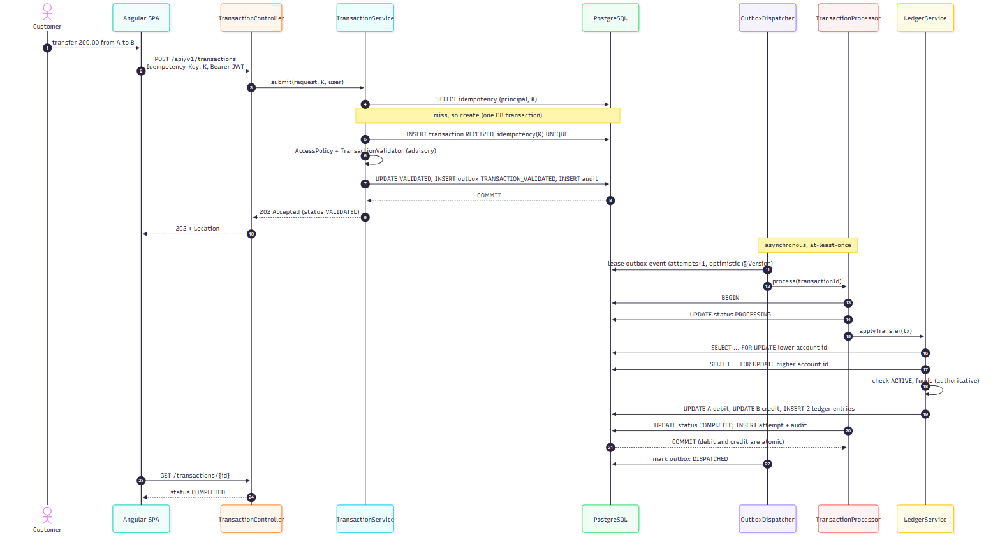
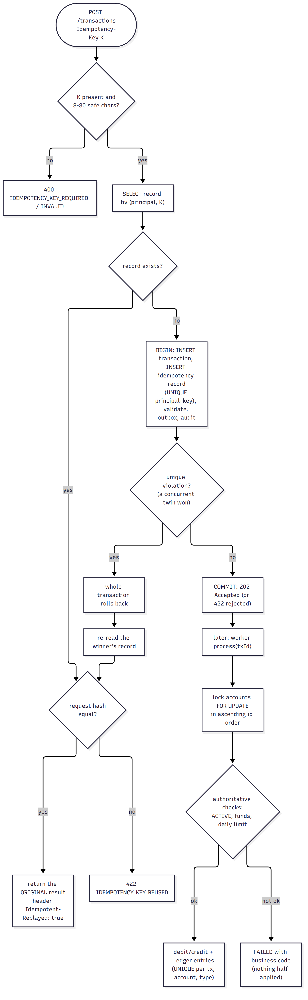
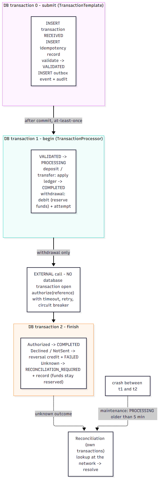
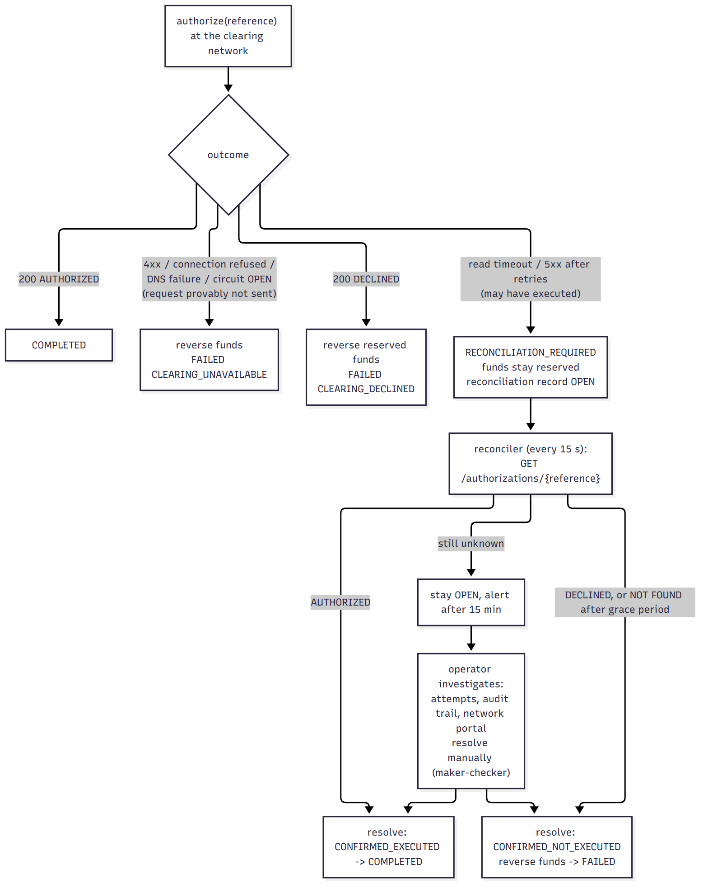

# Transaction integrity, concurrency and recovery

## Account transfer: end-to-end sequence

1. The SPA generates (or reuses) an `Idempotency-Key` and posts the transfer.
2. In **one database transaction** the service looks up the key, inserts the transaction as `RECEIVED` and the idempotency record,
   evaluates the rules, moves the transaction to `VALIDATED`, writes the outbox event and the audit rows, and commits. The client
   receives `202 Accepted`.
3. After commit, the dispatcher leases the outbox event and calls the processor.
4. The processor opens **one** database transaction, moves `VALIDATED -> PROCESSING`, locks the two account rows **in ascending id
   order**, re-checks status and funds, debits and credits, writes two ledger entries, moves to `COMPLETED`, records the attempt
   and the audit event, and commits. Debit and credit are in the same commit: it is impossible to observe (or crash into) a
   half-applied transfer.

## Idempotency and concurrency control

### Idempotency

* The key is scoped per principal: `UNIQUE (principal, idempotency_key)`. The **unique constraint is the arbiter**: the application
  does a fast read first, but correctness never depends on that read.
* When two requests with the same key race, both try to insert; the loser's *whole* transaction (transaction row, idempotency row,
  outbox row, audit rows) rolls back on the unique violation, then it re-reads the winner's record and replays it. Result: exactly
  one transaction, every caller gets the same answer (`IdempotencyIT.concurrentSameKeyCreatesOneTransaction`, 12 threads).
* The record stores a SHA-256 fingerprint of the canonical request. Same key + different payload -> `422 IDEMPOTENCY_KEY_REUSED`
  instead of silently returning stale data for a different request.
* Replays return the original status (`202`, or `422` for a rejection) plus `Idempotent-Replayed: true`.
* Retention: records are purged after 7 days (`TransactionMaintenance`); the retention period is the window in which a client
  may safely retry.

### Why the processor is idempotent too

The outbox guarantees *at-least-once* delivery. A second delivery finds the transaction no longer `VALIDATED` and returns
without effect; the `UNIQUE (transaction_id, account_id, entry_type)` constraint on ledger entries is a second, database-level
guard against applying the same posting twice.

### Locking strategy

| Mechanism | Used for | Why |
|---|---|---|
| **Pessimistic row lock** (`SELECT ... FOR UPDATE`, 5 s bounded wait) on `accounts` | every balance change | an account is a hot, contended row; a read-modify-write under optimistic locking would retry-storm under contention and could starve; with the lock the second request simply waits milliseconds and then sees the new balance |
| **Optimistic `@Version`** on customers, accounts, transactions, outbox, reconciliation | everything not under the row lock: cancel vs process, double approval, double resolution, concurrent profile edits | cheap, no lock held, conflicts are rare and the loser can re-read -> `409 CONCURRENT_MODIFICATION` |
| **Unique constraints** | idempotency, ledger postings, references, account numbers | the database is the only component that can decide a race between two application instances |
| **Lease + `@Version`** on the outbox | multiple dispatchers | claim by bumping `attempts` and pushing `available_at`; two claimers collide on `@Version`, only one wins; a crashed claimer's lease simply expires |
| **Lock ordering** (ascending account id) | transfers | a transfer A->B and B->A would otherwise each hold one row and wait for the other: the textbook deadlock. A total order makes the lock-wait graph acyclic (`LedgerServiceTest.locksInAscendingIdOrder`, `ConcurrencyScenarios.oppositeTransfersDoNotDeadlock`) |

**Optimistic versus pessimistic - how to choose.** Optimistic locking wins when conflicts are rare and retries are cheap
(profile edits, status changes). Pessimistic wins when the same row is *expected* to be contended and the critical section is
short (balances). The cost of pessimistic locking is lock waits and the *risk of deadlock*, which is handled by ordering and by a
bounded wait (a timeout becomes a retryable `503`, never a pile-up that exhausts the connection pool).

### Isolation levels and the race conditions they allow

The platform runs on the database default (`READ COMMITTED` on PostgreSQL) and gets its guarantees from row locks and constraints
rather than from raising the isolation level. For reference:

| Isolation | Prevents | Still allows | Relevance here |
|---|---|---|---|
| READ COMMITTED (PostgreSQL default) | dirty reads | non-repeatable reads, phantoms, **lost updates / write skew** | acceptable *because* every balance change is a locked read-modify-write |
| REPEATABLE READ (snapshot in PostgreSQL) | non-repeatable reads, phantoms | write skew; transactions can fail with serialization errors | would turn contention into retries; not needed with row locks |
| SERIALIZABLE (SSI in PostgreSQL) | all anomalies | none, at the price of aborts and retry logic | the "check balance, then debit" race is the textbook case SERIALIZABLE protects - we protect it explicitly with `FOR UPDATE` |

Race conditions the design closes, with the evidence that closes them:

| Race | Closed by | Test |
|---|---|---|
| two withdrawals overspend one balance | row lock + authoritative re-check | `concurrentWithdrawalsNeverOverspend` (20 requests, balance for 10 -> exactly 10 complete) |
| daily limit exceeded by parallel withdrawals | limit evaluated **under the account lock** | `concurrentWithdrawalsRespectDailyLimit` |
| duplicate submission | unique idempotency key | `concurrentSameKeyCreatesOneTransaction` |
| lost update on deposits | locked read-modify-write | `concurrentDepositsAreNotLost` (30 parallel, none lost) |
| deadlock on opposing transfers | ordered locks | `oppositeTransfersDoNotDeadlock` |
| cancel vs process | `@Version` on the transaction | `TransactionFlowIT.cancellation` |
| double delivery of an event | status check + unique ledger entry | `duplicateDeliveryIsHarmless` |

**Deadlocks** can still arise if some future code path locks accounts in a different order. Mitigations: all balance changes go
through `LedgerService` (one place), lock waits are bounded (5 s), and PostgreSQL's own deadlock detector aborts one victim
(surfacing as a retryable error). **Recovery strategy** for the failure modes:

| Failure | What happens | Recovery |
|---|---|---|
| process crashes after commit of submit | outbox row exists | next dispatcher tick processes it |
| crash during processing tx | transaction rolled back by the DB | outbox lease expires -> redelivery |
| crash after funds reserved, before outcome (withdrawal) | `PROCESSING` + reserved funds | recovery job moves it to `RECONCILIATION_REQUIRED` after 5 min; reconciler asks the network |
| poison event | repeated failures | `DEAD` after 5 attempts, alert, admin requeue |
| DB outage | requests fail fast (3 s connection timeout) | readiness probe fails, traffic drains; on return the outbox continues |

## Database transaction boundaries (processing)

The external call is deliberately **outside** any database transaction. Holding row locks and a pooled connection across a
network call that may take seconds (or hang) is how connection pools are exhausted and how one slow dependency takes the
whole system down. Instead the processor commits "funds reserved" first (so the money cannot be spent twice), calls the
network with a hard timeout, and then commits the outcome in a second short transaction.

> A database transaction does **not** provide distributed exactly-once processing across external systems. What the design
> provides instead is explicit states, idempotent calls (the network deduplicates on our `reference`), at-least-once internal
> delivery with idempotent consumers, and reconciliation for the unknowable case.

## Error handling and recovery for the external call

The key discipline is the three-way classification of the call's result:

| Result | Evidence | Action |
|---|---|---|
| **Authorized / Declined** | a definite answer from the network | complete, or refund + `FAILED` |
| **NotSent** | connection refused, DNS failure, 4xx, circuit open - the request provably never ran | refund immediately + `FAILED CLEARING_UNAVAILABLE` (safe to fail fast) |
| **Unknown** | read timeout, 5xx after retries - the network may have executed it | **do not refund**; `RECONCILIATION_REQUIRED`; reconcile |

Treating "unknown" as "failed" would pay the customer twice (refund now, payout later); treating it as "success" could hold funds for
a payout that never happened. Only reconciliation - asking the network - may decide.

Retries are applied **only** to the idempotent authorize call (the network deduplicates on `reference`), with exponential backoff
and *full jitter* so many instances do not retry in lock-step against a recovering dependency. A circuit breaker (50 % failures over 10
calls, 10 s open) converts a sustained outage into immediate, cheap `NotSent` failures instead of every request waiting out its
timeouts; the end-to-end run with the chaos switch exercised exactly this (docs/validation).
