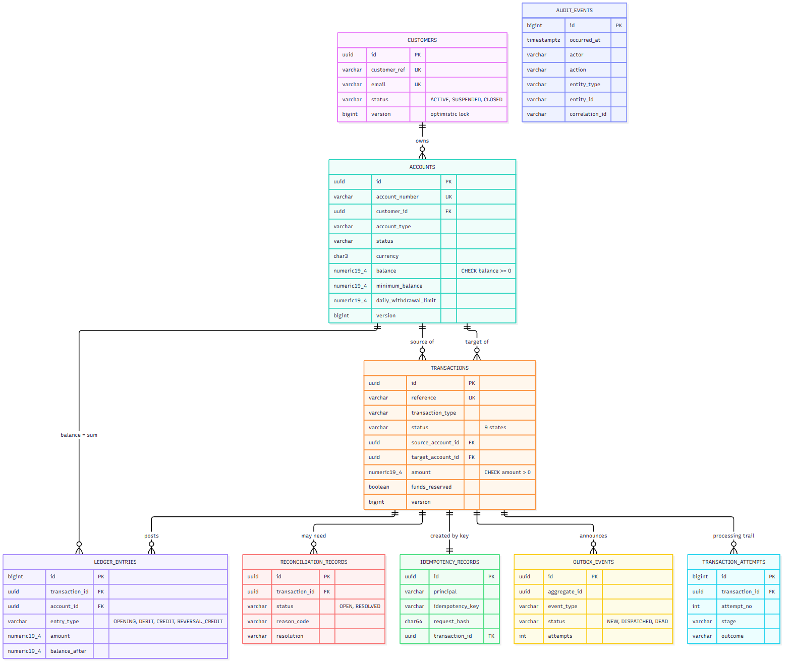

# Database design and performance

## Choice: PostgreSQL (ADR-002)

PostgreSQL is the system of record. Reasons: strong ACID semantics with MVCC (readers never block writers), mature row-level
locking (`FOR UPDATE`, `SKIP LOCKED`), partial and expression indexes, `CHECK` constraints, transactional DDL (migrations are
atomic), excellent tooling (`EXPLAIN ANALYZE`, `pg_stat_statements`), open source and available as a managed service on every
cloud (RDS/Aurora PostgreSQL). MySQL/InnoDB would also work; PostgreSQL's partial indexes and transactional DDL were decisive.
An in-memory **H2 in PostgreSQL mode** is used for zero-install local runs and fast tests; the PostgreSQL-specific migration and
behaviour are verified on a real PostgreSQL server (embedded PostgreSQL 14 in the test suite, `postgres:16.4` in Docker Compose and in
the optional Testcontainers test).

## Schema



Normalised to third normal form; the denormalisations are deliberate and cheap: `balance` on `accounts` (a materialised sum of
`ledger_entries`, kept honest by `/ops/ledger-integrity`), `balance_after` on ledger entries (point-in-time statement without a
window query), `funds_reserved` on transactions (so reversal is idempotent).

| Table | Purpose | Key constraints |
|---|---|---|
| `customers` | profile | `UNIQUE(customer_ref)`, `UNIQUE(email)`, status `CHECK` |
| `accounts` | balances | `UNIQUE(account_number)`, FK customer, **`CHECK (balance >= 0)`**, minimum/limit non-negative, `@Version` |
| `transactions` | requests and lifecycle | `UNIQUE(reference)`, FKs to both accounts, **`CHECK (amount > 0)`**, **`CHECK` that source/target match the type** (deposit: target only; withdrawal: source only; transfer: both and different), status `CHECK` |
| `transaction_attempts` | processing trail | `UNIQUE(transaction_id, attempt_no)` |
| `idempotency_records` | duplicate protection | **`UNIQUE(principal, idempotency_key)`**, FK transaction |
| `ledger_entries` | immutable postings | **`UNIQUE(transaction_id, account_id, entry_type)`** (blocks double posting), `amount >= 0` |
| `reconciliation_records` | uncertain outcomes | status `CHECK`; PostgreSQL: **partial unique index** `WHERE status = 'OPEN'` (one open record per transaction) |
| `outbox_events` | reliable async hand-off | status `CHECK` (`NEW`, `DISPATCHED`, `DEAD`) |
| `audit_events` | audit trail | indexes on `(entity_type, entity_id, id)`, `(occurred_at)`, `(action, occurred_at)`; PostgreSQL: **trigger forbids UPDATE/DELETE** (append-only) |

Money columns are `NUMERIC(19,4)`. UUID primary keys are generated by the application (random v4). Trade-off: random UUIDs
scatter inserts across the B-tree (worse locality than a sequence or UUIDv7); a time-ordered UUID (v7) is the documented upgrade
if insert rate ever makes index bloat measurable.

## Flyway migrations and safe schema evolution

```
db/migration/common/V1__core_schema.sql         portable schema (PostgreSQL + H2)
db/migration/postgresql/V2__postgresql_hardening.sql   partial indexes, append-only trigger (PostgreSQL only)
db/migration/h2/V2__h2_equivalents.sql          plain-index equivalents for H2
db/seed/V1000__synthetic_seed_data.sql          synthetic demo data (local profile / tests only)
```

`spring.flyway.locations: classpath:db/migration/common,classpath:db/migration/{vendor}` lets each database get its own V2. The
application runs with `ddl-auto: validate`, so Hibernate only checks the mapping against the migrated schema. (A real defect was
caught this way: a `VARCHAR(20)` column too short for `CONFIRMED_NOT_EXECUTED`, found by the integration tests before any
release; V1 was edited because nothing was deployed - after the first deployment **migrations are never edited**.)

**Expand/contract for zero-downtime changes:** (1) *expand* - add the new nullable column/table/index (`CREATE INDEX CONCURRENTLY` on
PostgreSQL), deploy code that writes both; (2) *backfill* in small batches; (3) deploy code that reads the new shape; (4) *contract* -
drop the old column in a later release, after the rollback window. Never rename or drop in the same release as the code change.
Large-table index builds and `NOT NULL` additions are done in steps to avoid long locks.

## Indexes and why

| Index | Serves | Notes |
|---|---|---|
| `ix_tx_source_created (source_account_id, created_at DESC)`, `ix_tx_target_created` | per-account history, daily-limit sum | newest-first order matches the default sort |
| `ix_tx_status_created (status, created_at DESC)` | status filters, dashboards | |
| `ix_tx_attention` *(PostgreSQL partial: `WHERE status IN ('PENDING_REVIEW','RECONCILIATION_REQUIRED','FAILED')`)* | operations queues | tiny index over a tiny fraction of rows |
| `uq_idempotency_principal_key` | duplicate detection **and** arbitration | the one index that is a correctness mechanism |
| `ix_outbox_status_available (status, available_at)` | dispatcher polling | |
| `ix_ledger_account (account_id, id)` | statement/ledger reads, integrity check | |
| `uq_recon_open_per_tx` *(partial unique)* | at most one OPEN record per transaction | H2 cannot express it; `ReconciliationService.open` guards in code |

## Query plans (real, captured on PostgreSQL)

The plans below are produced by `PostgresFeaturesIT.queryPlans` with `EXPLAIN (ANALYZE, COSTS OFF)` on a real PostgreSQL server
loaded with 100,000 synthetic transactions over 20 accounts. They are regenerated on every full build
(`backend/platform-service/target/query-plans.txt`) and the captured run is included in the PDF as an appendix.

Reading them: the *shape* matters (which index, sort or filter), not the timings (omitted on purpose: shared developer machine).

* **Account history for a busy account** - PostgreSQL walks `ix_tx_created` newest-first and filters; for an account holding 5 % of all
  rows it finds 20 matches after ~400 index entries, which is cheaper than two bitmap scans plus a sort.
* **Account history for a sparse account** - the planner switches to the per-account indexes (bitmap OR of
  `ix_tx_source_created`/`ix_tx_target_created`), because walking the global index would discard almost everything.
* **Honest caveat:** the `source = :id OR target = :id` predicate is the weak spot. It works because each side has its own index and
  PostgreSQL can combine them, but at very large scale the clean answer is to split it into two index-friendly queries
  (`UNION ALL ... ORDER BY created_at DESC LIMIT n`) or to add a `transaction_participants (account_id, created_at, transaction_id)`
  table, and to move deep pagination to keyset pagination.
* Idempotency lookup, outbox polling and the row lock all use their intended indexes (primary/unique/composite).

## Connection pool, transactions, timeouts

HikariCP: `maximum-pool-size 20`, `minimum-idle 5`, `connection-timeout 3 s` (fail fast), `max-lifetime 25 min` (below typical
network idle cut-offs), `leak-detection-threshold 30 s`. Sizing rule of thumb: pool size is bounded by what the **database** can
run concurrently (cores x 2-4), *not* by the number of request threads; more connections beyond that only adds contention. Each
instance's pool times the replica count must stay below PostgreSQL `max_connections` (or use PgBouncer).
`open-in-view: false` so no connection is held while rendering responses. Row-lock waits are bounded to 5 s
(`jakarta.persistence.lock.timeout`). The external call is made with **no** connection held (see transaction boundaries).

## Useful SQL

```sql
-- the invariant that must always hold: balance equals the signed sum of ledger entries (empty result = healthy)
SELECT a.id, a.balance, COALESCE(SUM(CASE WHEN e.entry_type = 'DEBIT' THEN -e.amount ELSE e.amount END), 0) AS ledger_sum
FROM accounts a LEFT JOIN ledger_entries e ON e.account_id = a.id
GROUP BY a.id, a.balance
HAVING a.balance <> COALESCE(SUM(CASE WHEN e.entry_type = 'DEBIT' THEN -e.amount ELSE e.amount END), 0);

-- the attention queue operations works from
SELECT reference, status, failure_code, created_at FROM transactions
WHERE status IN ('PENDING_REVIEW','RECONCILIATION_REQUIRED','FAILED') ORDER BY created_at DESC LIMIT 50;

-- who holds locks / who is blocked right now (investigating lock contention)
SELECT blocked.pid AS blocked_pid, blocking.pid AS blocking_pid, blocked.query AS blocked_query, blocking.query AS blocking_query
FROM pg_stat_activity blocked
JOIN pg_stat_activity blocking ON blocking.pid = ANY (pg_blocking_pids(blocked.pid))
WHERE blocked.wait_event_type = 'Lock';

-- slowest statements (needs the pg_stat_statements extension)
SELECT calls, round(mean_exec_time::numeric, 2) AS mean_ms, left(query, 100) FROM pg_stat_statements ORDER BY mean_exec_time DESC LIMIT 10;
```

## Data retention considerations

| Data | Retention in this implementation | Production consideration |
|---|---|---|
| idempotency records | 7 days (scheduled purge) | must outlive the longest client retry window |
| audit events | kept (append-only) | regulatory retention (often 5-7 years) -> partition by month, archive cold partitions to cheap storage, never delete from the hot table |
| transactions, ledger | kept | partition `transactions` by `created_at`; archive after the reporting window |
| outbox | `DISPATCHED` rows accumulate | delete or partition-drop rows older than N days |
| PII | masked in views and logs; taxpayer fragment never returned | encryption at rest (KMS), field-level encryption for identifiers, right-to-erasure design |

## Oracle in an enterprise deployment (conceptual - Oracle is not run here)

Many enterprises standardise on Oracle. The design ports with these differences (no second database was added because there
is no implementation need):

| Topic | PostgreSQL (this repo) | Oracle |
|---|---|---|
| Identity / sequences | UUID in app; `GENERATED ALWAYS AS IDENTITY` | `GENERATED ALWAYS AS IDENTITY` (12c+) or sequences; `RAW(16)` for UUIDs |
| Pagination | `LIMIT n OFFSET m` | `OFFSET m ROWS FETCH NEXT n ROWS ONLY` (12c+) |
| Locking read | `SELECT ... FOR UPDATE [NOWAIT / SKIP LOCKED]` | `SELECT ... FOR UPDATE [NOWAIT / WAIT n / SKIP LOCKED]` |
| Default isolation | READ COMMITTED (statement snapshot) | READ COMMITTED (statement-level read consistency via undo) - same anomalies, `ORA-08177` on SERIALIZABLE conflicts |
| Empty string | distinct from NULL | **`'' IS NULL`** - validation and uniqueness logic must account for it |
| Boolean | `BOOLEAN` | no SQL `BOOLEAN` before 23ai: `NUMBER(1)` + check |
| Timestamps | `TIMESTAMPTZ` | `TIMESTAMP WITH TIME ZONE` |
| Partial indexes | yes | no - function-based indexes (e.g. index on `CASE WHEN status='OPEN' THEN transaction_id END`) |
| DDL in transactions | transactional | DDL auto-commits - migrations are not atomic |
| Hints / plans | planner statistics, `EXPLAIN` | CBO, `EXPLAIN PLAN`, AWR/ASH reports, SQL plan baselines |
| JPA dialect | `PostgreSQLDialect` | `OracleDialect`; `NUMBER(19,4)` for money, `VARCHAR2` |

In Spring Boot the port is: add the Oracle JDBC driver, set the dialect, provide an `oracle` Flyway vendor folder next to
`postgresql`/`h2`, replace partial indexes with function-based ones, and re-run the same concurrency tests.

## MongoDB: where it would (and would not) fit

Not used for the ledger - financial invariants want relational constraints and multi-row ACID. Good fits around the edges:
a **read model** of denormalised account activity for fast customer-facing history, **semi-structured documents** (KYC document
metadata, notification payloads), and an **event/audit sink** with flexible schema and TTL indexes. Rule: one system of record per
fact; Mongo copies are projections rebuilt from events, never the source of truth.
