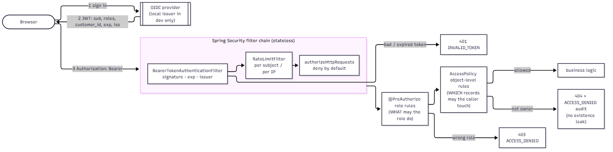

# Authentication, authorization and security architecture

## Authentication and authorization flow

### Authentication (OAuth 2.0 / OIDC compatible)

`platform-service` is an **OAuth 2.0 resource server**. It never sees passwords: clients present `Authorization: Bearer <JWT>` and the
service validates **signature, expiry and issuer**. Two interchangeable configurations:

| Mode | Used for | How it validates |
|---|---|---|
| **OIDC (production-style)** | any shared environment | `spring.security.oauth2.resourceserver.jwt.issuer-uri` (`OIDC_ISSUER_URI`): the issuer's discovery document and JWKS are fetched and cached; asymmetric signatures (RS256/ES256); keys rotate at the provider |
| **Local issuer** | laptop demo and tests only | `LocalIssuerConfig` + `LocalAuthController`: an HS256 key (random per start unless `LOCAL_ISSUER_HMAC_SECRET` is supplied) signs tokens for seven synthetic users; the application **refuses to start** if it is enabled together with a `prod`/`production` profile; absent from the Kubernetes configuration (a validation check asserts that) |

Claims used: `sub` (principal; also the audit actor and idempotency scope), `roles` (array), `customer_id` (links a `CUSTOMER`
to their customer record). Unknown role names are **ignored** (least privilege) - a token granting `SUPER_ADMIN` grants nothing
(`SecurityIT.unknownRoleGrantsNothing`).

Token handling in the SPA: the access token is kept **in memory only** (never `localStorage`/`sessionStorage`), so XSS cannot read it
from storage and it dies with the tab; trade-off: a reload requires signing in again - production would use authorization-code +
PKCE (ideally via a backend-for-frontend with an HttpOnly cookie) for silent renewal. The interceptor attaches the token only to
`/api/` URLs.

### Authorization - two layers

1. **Role-level** (`@PreAuthorize`, `SecurityConfig`): *what may this role do?* e.g. only `ADMIN` can close an account or drain the outbox.
2. **Object-level** (`AccessPolicy`, pure functions): *which records may this caller touch?* A `CUSTOMER` may only see accounts whose
   `customer_id` equals the `customer_id` claim; a transfer must stay inside one customer; staff may look but only operators
   may change; **maker-checker** forbids reviewing your own submission regardless of role. Denials return `404` (existence is not
   revealed) and write an `ACCESS_DENIED` audit event in an *independent* transaction (so it survives the rollback of the failed
   request).

The authorization matrix is exhaustively unit-tested (`AccessPolicyTest`) and exercised end to end (`SecurityIT`: ~18 tests including
BOLA on accounts, balances, history, ledger, transaction read/cancel/approve, search scoping, submission against others' accounts,
orphan tokens).

## Deny by default and hardening

| Control | Implementation |
|---|---|
| Deny by default | `authorizeHttpRequests`: only listed paths are permitted; `anyRequest().denyAll()` |
| Stateless, no session | `SessionCreationPolicy.STATELESS`; CSRF disabled **deliberately**: tokens travel in the `Authorization` header, which browsers never attach automatically - CSRF is a cookie problem; the code comment says to re-enable it if cookies are ever introduced |
| CORS | explicit origin allow-list (`CORS_ALLOWED_ORIGINS`), no wildcard, no credentials, listed headers; preflight tested |
| Security headers | `X-Content-Type-Options`, `X-Frame-Options: DENY`, `Referrer-Policy: no-referrer`, HSTS, CSP, `Cache-Control: no-store` |
| Request limits | 64 KB body limit incl. chunked; sort whitelist; page size cap 100 |
| Rate limiting | token bucket per subject (API) and per address (login) |
| Input validation | Bean Validation on DTOs, allow-list regex for memo, `@Digits`, strict JSON (unknown fields rejected), UUID typed path variables |
| SQL injection | JPA/JPQL with bound parameters and the Criteria API only; search strings are data (`SecurityIT.inputHardening`) |
| Error handling | one envelope; no stack traces, SQL or payload echo; correlation id for support |
| Sensitive data | emails/phones masked for support agents; tax-id fragment never returned; account numbers masked in audit text; no PII in logs; amounts are not secrets but are never logged with identities beyond ids |
| Audit | every state change and every access denial; append-only trigger on PostgreSQL |
| Secrets | none committed; compose requires them from `.env` (no defaults for secret values); Kubernetes references an `ExternalSecret`; CI scans for leaks (gitleaks) |
| Dependencies | OWASP Dependency-Check (CVSS >= 7 fails), `npm audit`, Trivy image scan, Dependabot-ready pinned versions |
| Containers | non-root, read-only filesystem, all capabilities dropped, `no-new-privileges`, restricted pod security namespace, default-deny NetworkPolicy |

## OWASP mapping

The OWASP Top 10 (2021) and OWASP API Security Top 10 (2023) mapping to concrete controls and tests is in
`docs/security/owasp-mapping.md` (and in the PDF as part of the threat-model chapter).

## Educational implementation versus a production financial system

This repository demonstrates the *engineering* of a secure design with synthetic data. It is **not** security-reviewed for production
use. A production deployment still needs: an independent security assessment and penetration test; formal threat modelling with the
organisation's risk team; key-management design (HSM/KMS), field-level encryption and tokenisation of identifiers; mTLS or a service
mesh between services; WAF and DDoS protection; SIEM integration and alerting on audit events; privileged-access management and
break-glass procedures; a distributed rate limiter; SCA/SAST gates with an exception process; data-residency and retention policy;
compliance validation (e.g. SOC 2, PCI DSS if card data were ever in scope, GDPR/CCPA); and operational governance.
