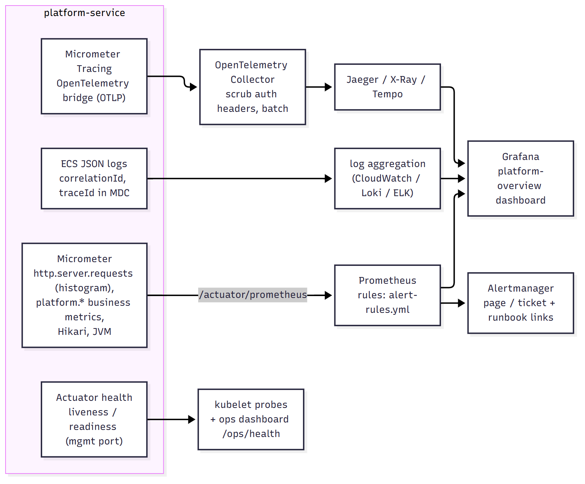

# Observability architecture

Three pillars plus health, all wired to the same correlation id.

## Logs

* Console logs; in containers `LOG_STRUCTURED_FORMAT=ecs` switches Spring Boot's built-in **structured logging** to Elastic Common
  Schema JSON (no extra dependency). Local runs keep a readable pattern: `%5p [%X{correlationId}] ...`.
* `CorrelationIdFilter` puts `correlationId` in the MDC for every request (safe-token validation blocks log injection), the structured
  format includes MDC entries and the trace id, the error envelope returns it, and `audit_events.correlation_id` stores it - one id
  joins the UI action, the log lines, the trace and the audit trail.
* Logging discipline: no PII, no tokens, no request bodies; account numbers masked (`Masking`); exceptions are logged once
  server-side at the point they are mapped to a response.

## Metrics

Prometheus scrape of `/actuator/prometheus` (management port `9090` in containers, never routed through the ingress).

| Metric | Source | Why |
|---|---|---|
| `http_server_requests_seconds_{count,sum,bucket}` (histogram + 0.5/0.95/0.99 + SLO buckets 100 ms/300 ms/1 s) | Spring Boot | latency percentiles, request and 5xx **error rate** (RED) |
| `platform_transactions_submitted_total{type,result}` | `PlatformMetrics` | submission volume and validation outcomes |
| `platform_transactions_finished_total{type,status}` | `PlatformMetrics` | terminal outcomes, failure rate |
| `platform_transactions_end_to_end_seconds` (histogram) | `PlatformMetrics` | **transaction-processing latency** (submit -> terminal state) |
| `platform_reconciliation_open`, `platform_outbox_backlog`, `platform_outbox_dead` | gauges (DB counts) | **queue metrics**: uncertain outcomes, pending work, dead letters |
| `platform_clearing_circuit_open` | gauge | circuit breaker state |
| `hikaricp_connections_{active,idle,pending,max}`, `hikaricp_connections_acquire_seconds` | HikariCP | **connection-pool** saturation |
| `jvm_memory_*`, `jvm_gc_pause_seconds_*`, `jvm_threads_*`, `process_cpu_usage` | Micrometer JVM binders | memory, GC, thread starvation |

The Grafana dashboard `observability/grafana/dashboards/platform-overview.json` (provisioned automatically in Compose) charts all of the above;
`observability/prometheus/alert-rules.yml` defines 11 alerts, each linking to a runbook section (a validation check fails the build if
an alert has no runbook).

## Traces

Micrometer Tracing with the OpenTelemetry bridge exports OTLP (`OTLP_TRACES_ENDPOINT`) to an OpenTelemetry Collector (which scrubs
`authorization`/`cookie` attributes) and then to Jaeger (X-Ray/Tempo in AWS). Sampling is `TRACING_SAMPLING` (1.0 in dev, 0.1 in the
test overlay) and export is off unless `OTLP_EXPORT_ENABLED=true` - tracing is opt-in per environment. Outgoing REST calls to the
clearing network are instrumented automatically by the Spring `RestClient` observation, so the trace shows the external hop
and its retries.

## Health

`/actuator/health/liveness` and `/readiness` (Kubernetes probes). The staff-only `/api/v1/ops/health` is the **business** view that the
dashboard shows: database round trip, clearing network reachability and circuit state, outbox backlog/dead letters, open
reconciliation records - status `UP`, `DEGRADED` (dead letters or a degraded dependency) or `DOWN` (database unreachable).

## From signal to action

Alert -> runbook section (`docs/operations/runbooks.md`) -> dashboard panel -> correlation id -> logs/trace/audit trail. The
investigation guides (`docs/operations/performance-troubleshooting.md`) walk from each symptom (high memory, long GC, thread
starvation, slow SQL, pool exhaustion, lock contention, elevated latency, database outage, partial failure) to its cause.
