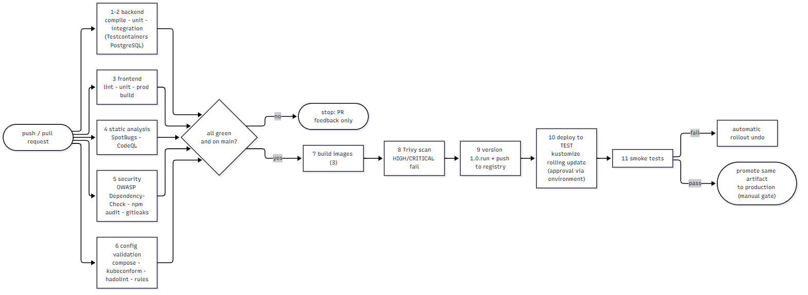
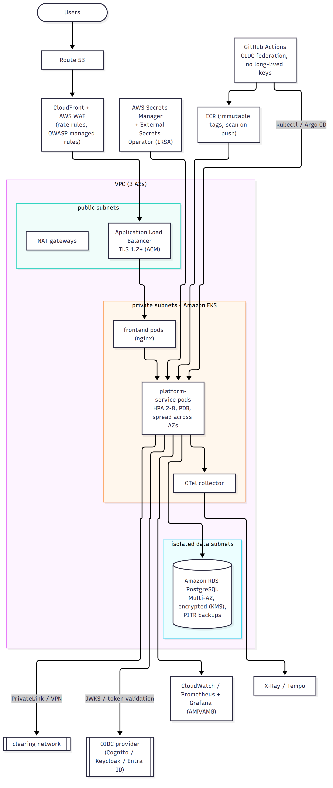

# CI/CD pipeline and cloud deployment

## CI/CD pipeline

Implemented in `.github/workflows/ci.yml` (GitHub Actions). **Status: reviewed and every constituent command executed locally where
tooling allowed, but the workflow itself has not been run on a GitHub runner** (stated plainly in the validation report).

| # | Stage | Job | Gate |
|---|---|---|---|
| 1 | Java compilation + unit tests (JUnit 5, Mockito) | `backend` | any failure stops the pipeline |
| 2 | Integration tests (Spring context, H2, embedded/Testcontainers PostgreSQL) | `backend` (failsafe `*IT`) | |
| 3 | Angular lint, unit tests (Karma/Jasmine, headless Chrome), production build | `frontend` | lint errors fail |
| 4 | Static analysis | `static-analysis`: SpotBugs (medium+), CodeQL (Java + TypeScript) | findings fail |
| 5 | Dependency vulnerability scanning + secret scanning | `security-scan`: OWASP Dependency-Check (CVSS >= 7), `npm audit`, gitleaks | fail on high CVEs / leaked secrets |
| 6 | Configuration validation | `config-validation`: `scripts/validate-infra.sh` (compose, kubeconform, hadolint, alert rules vs. metrics, dashboards, secret patterns) | |
| 7 | Container image build (3 images, layer-cached) | `images` | |
| 8 | Container image scanning | Trivy, fails on HIGH/CRITICAL with a fix available | |
| 9 | Artifact versioning + publish | `1.0.<run number>` and `sha-<short>` tags to the registry, **main only** | |
| 10 | Deployment to a test environment | `deploy-test`: kustomize overlay, rolling update, `rollout status`; skipped without credentials | environment protection rules (reviewers) |
| 11 | Post-deployment smoke tests | `scripts/smoke-test.sh`: liveness, 401 on protected endpoints, security headers, actuator not exposed | failure triggers `kubectl rollout undo` |

Design points: least-privilege `permissions:`; concurrency group cancels superseded runs; build **once**, promote the same image
through environments (no rebuild per environment); the OpenAPI contract is re-generated by the tests and `git diff --exit-code
specs/openapi.json` fails the job if the committed contract is stale; credentials for cluster access exist only as environment
secrets (prefer OIDC federation to the cloud provider over long-lived keys); production promotion is a manual approval of the
*same* artefact. Branch protection requires the `backend`, `frontend`, `static-analysis` and `security-scan` jobs.

## Local infrastructure

`infrastructure/docker-compose.yml` runs PostgreSQL, the platform, the simulator, the nginx-served SPA, Prometheus, Grafana, the
OpenTelemetry Collector and Jaeger. Hardening applied even locally: the database is not published to the host, secrets must come
from `.env` (compose refuses to start otherwise), app containers are read-only with all capabilities dropped, networks are split
(`backend`, `frontend`, `observability`), the app has a health check and a `stop_grace_period` longer than Spring's shutdown phase.
**Not executed by the author** (no Docker on the machine) - validated statically.

## Kubernetes

`infrastructure/k8s/base`: namespace with the *restricted* pod-security level, ConfigMap (no secrets), Deployments, Services, HPA
(2-8 replicas at 65 % CPU), PodDisruptionBudget, Ingress with TLS, and NetworkPolicies (default deny; the API accepts traffic only from the
frontend and, on the management port, from the monitoring namespace). `overlays/test` adds the simulator and a single replica.

* **Probes:** startup (3 minutes for Flyway/warm-up), liveness, readiness on the management port.
* **Rolling updates:** `maxUnavailable: 0, maxSurge: 1` - a ready pod is never removed before its replacement is ready.
* **Graceful shutdown:** `preStop: sleep 10` lets the load balancer deregister the pod, then `SIGTERM` makes Spring stop accepting
  requests and drain for up to 20 s (`server.shutdown=graceful`, scheduler `await-termination`); `terminationGracePeriodSeconds: 45`.
* **Resources:** CPU request, **memory limit only** (CPU limits throttle JVMs and create latency spikes), JVM `MaxRAMPercentage=75`.
* **Secrets:** only `secretKeyRef`s; the Secret is created by External Secrets Operator from AWS Secrets Manager/Vault
  (`external-secret.example.yaml`).
* **Autoscaling caveat:** the dispatcher/reconciler run in every replica; they are safe to run concurrently (lease + optimistic
  locking), so scale-out never double-processes.

## AWS reference architecture

* **Edge:** Route 53 -> CloudFront + **AWS WAF** (managed OWASP rule sets, rate rules) -> ALB (TLS via ACM).
* **Compute:** Amazon **EKS** across three AZs (private subnets); nodes patched via managed node groups; images in **ECR** (immutable tags,
  scan on push). ECS Fargate is a lighter alternative for a team without Kubernetes expertise.
* **Data:** Amazon **RDS for PostgreSQL**, Multi-AZ, encrypted with KMS, automated backups with point-in-time recovery, parameter group tuned
  (`max_connections`, `lock_timeout`, `statement_timeout`), read replica for reporting; connection pooling via the app (Hikari) or RDS Proxy.
* **Secrets:** AWS Secrets Manager (rotation) surfaced by External Secrets with **IRSA** (pod-level IAM, no node-wide credentials).
* **Identity:** an OIDC provider (Cognito, Keycloak, Entra ID) issues JWTs; the API only needs the issuer URL.
* **Observability:** Prometheus (Amazon Managed Prometheus) + Grafana (AMG), CloudWatch Logs for ECS-format JSON, X-Ray or Tempo via the
  OpenTelemetry Collector.
* **Pipeline:** GitHub Actions with OIDC federation to AWS (no static keys), pushes to ECR, deploys with `kubectl`/Argo CD.
* **Environment-specific configuration:** one ConfigMap per environment through kustomize overlays; behaviour flags
  (`app.processing.*`, rate limits, tracing sampling) are plain environment variables; nothing environment-specific is baked into the image.
* **Scaling:** HPA on CPU (add a custom metric on `platform_outbox_backlog` for processing throughput), RDS vertical scaling plus replicas,
  CloudFront/WAF absorbing abusive traffic.
* **Rollback:** application: `kubectl rollout undo` (previous ReplicaSet, seconds) or Argo CD revert; **database: forward-only
  migrations with the expand/contract pattern, so the previous application version always works against the new schema** (rolling
  the schema back is a last resort and means point-in-time recovery); feature flags/config for risky behaviour.
* **No cloud credentials are needed for the default development workflow** - the whole system runs locally with H2 and the simulator.
