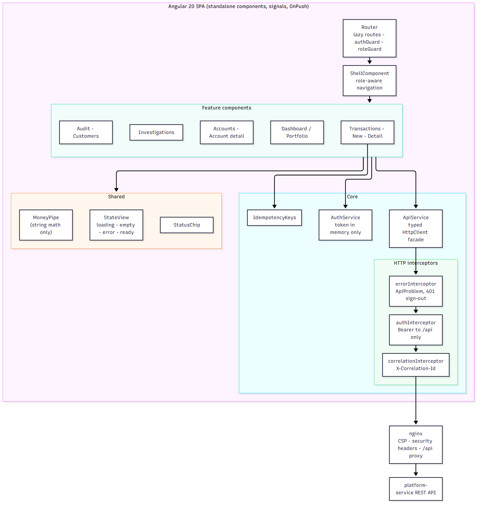

# Angular frontend architecture

> A React edition of the same console lives in `frontend-react/` - see [12-react-frontend.md](12-react-frontend.md) and ADR-013.



## Stack and conventions

Angular 20 (standalone components, no NgModules), TypeScript strict mode, Angular Material 20 for accessible building blocks,
RxJS for HTTP streams and **signals** for component state (`signal`, `computed`, `input()`), `OnPush` change detection everywhere,
lazy-loaded routes, Reactive Forms, `HttpClient` with functional interceptors, Karma + Jasmine for unit/component tests, ESLint with
`angular-eslint` including the template-accessibility rules. No React/Vue/JSX anywhere.

```
src/app/
  core/       auth.service (token in memory), api.service (typed facade), interceptors, guards, idempotency keys, models
  shared/     money.pipe, status-chip, state-view (loading/empty/error/ready), transaction-table
  features/   login, shell (role-aware nav), home (dashboard | portfolio), accounts, customers, transactions, investigations, audit
```

## Routing, guards, role-aware navigation

* Every route except `/login` is behind `authGuard` (redirects to `/login?returnUrl=...`; the login component only follows
  in-app relative return URLs, defeating open redirects).
* Staff-only pages add `roleGuard` with `data.roles`; the navigation list in `ShellComponent` is filtered by the same roles.
  **This is UX, not security** - the API enforces everything (a customer who forces `/audit` gets the "not permitted" page and, if
  they call the API directly, a 403).
* Routes are lazy (`loadComponent`): the initial bundle is ~340 kB raw / ~97 kB transferred; each feature loads on demand.

## HTTP layer

| Piece | Responsibility |
|---|---|
| `ApiService` | one typed method per endpoint; builds params with `toParams` (drops empty filters, repeats array params); **no business rules** |
| `authInterceptor` | adds `Authorization: Bearer` to `/api/` calls only, never to the login call or third-party URLs |
| `correlationInterceptor` | adds `X-Correlation-Id` so a click can be found in server logs |
| `errorInterceptor` | normalises every failure into an `ApiProblem {status, code, message, violations, details, correlationId}`; a `401` on a protected call signs the user out; network errors get a friendly message |
| `IdempotencyKeys` | reuses the same key while the payload is unchanged (safe retry, double click), issues a new key when the user edits, resets after a definitive outcome |

## State handling

Every data view uses the same four states through `StateViewComponent`: **loading** (spinner in a polite live region), **error**
(alert role + retry button), **empty** (explanatory text), **ready**. The dashboard keeps the last good data and shows a non-blocking
warning when an automatic refresh fails (it refreshes every 15 s while the tab is visible).

## Forms and accessibility

Reactive Forms with typed controls; every control has a visible label; errors are announced (`mat-error`, `role="alert"`); the submit button
disables while a request is in flight (a second submit is ignored); the new-transaction form applies the same shape rules as the server
(deposit needs a target, withdrawal a source, transfer two different accounts) and the same amount pattern (positive, <= 2 decimals) - **client
validation is a convenience; the server is authoritative**. Status is never conveyed by colour alone (chips carry text), the sidenav marks the
current page with `aria-current`, and a CSS-only responsive layout (checked at 390 px by the browser E2E test) collapses the sidenav to an overlay.

## Money on the client

The API returns money as **strings**; the SPA never converts them to numbers. `MoneyPipe` groups digits by string manipulation (tested with a value
beyond 2^53 to prove no float rounding), and the form submits the typed string as-is.

## Secure frontend practices

* Token in memory only; no `innerHTML`/`bypassSecurityTrust*` anywhere (Angular's template sanitisation is left on);
* strict CSP delivered by nginx (`default-src 'self'`; scripts same-origin only);
* same-origin deployment (`/api` proxied by nginx or the dev server) so no CORS and no third-party origins;
* returnUrl validation, no secrets in the bundle, `npm audit` in CI.

## Testing

58 unit/component tests (Karma + Jasmine in headless Edge/Chrome): money pipe, status chip, state view, auth service (memory-only token,
expiry), all three interceptors, guards, `ApiService` URL/param building, idempotency key policy, the new-transaction form (validation,
double-submit protection, 422 handling, safe retry with the same key, new key on edit, replay notice), the dashboard (loading, ready, error + retry,
stale-data warning, empty states), login (validation, 401/429 messages, open-redirect guard), role-aware navigation, maker-checker button visibility
on the transaction page, investigations resolve flow. A browser E2E script (`tests/e2e/ui-e2e.mjs`) drives the production bundle through the customer,
operations and support journeys against the live backend.
