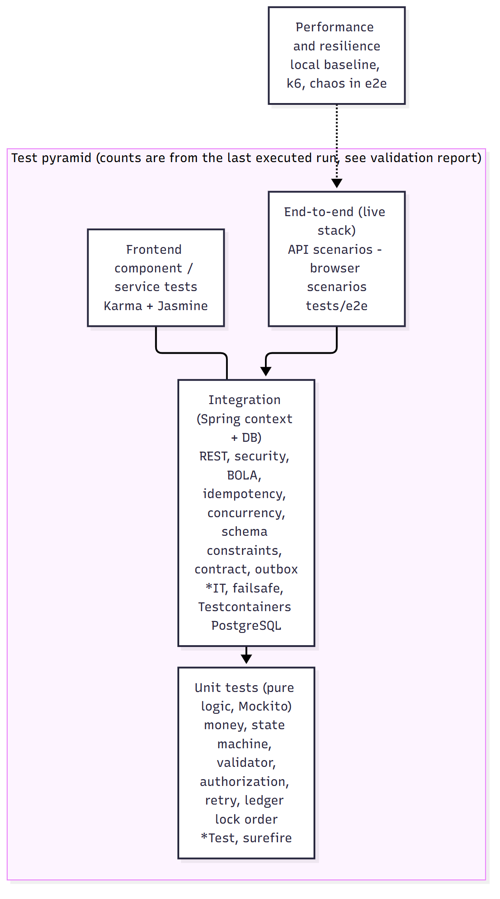

# Test strategy



## Principles

1. **Test the money invariants hardest.** The properties that must never break are: balance never negative, balance == sum of ledger,
   a transfer is all-or-nothing, a key is applied once, no cross-customer access. They are asserted after *every* concurrency scenario
   (`assertLedgerIntegrity()`), not just where a test is "about" them.
2. **Pure logic gets unit tests; wiring gets integration tests; journeys get end-to-end tests** - and each layer is kept small enough
   to run often. Business rules are deliberately written as pure functions (`TransactionValidator`, `AccessPolicy`, `DailyLimitPolicy`,
   `MoneyPolicy`) so each rule is one assertion.
3. **Real infrastructure where behaviour depends on it.** Locking, isolation, constraints, migrations and query plans are tested against a
   real database (H2 in PostgreSQL mode for speed, a real PostgreSQL 14 embedded in the test JVM for fidelity, Testcontainers in CI).
4. **Do not claim what was not executed.** Test counts in this document come from executed runs recorded in
   `docs/validation/validation-report.md`; anything not run is listed there as not run.

## Layers

| Layer | Tooling | Location | What it proves |
|---|---|---|---|
| Unit (backend) | JUnit 5, AssertJ, Mockito | `src/test/**/*Test.java` (surefire) | money policy (precision, HALF_EVEN, allocation, equals vs compareTo), 81-pair state machine, validator rules, authorization matrix, retry/jitter, token bucket, daily-limit policy (TDD), ledger **lock ordering** and compensation, processor outcome mapping (Declined/NotSent/Unknown), outbox dispatcher lease/backoff/dead-letter, idempotency fingerprint, REST clearing client against a real in-JVM HTTP server (retries, timeouts, circuit breaker, outcome classification) |
| Integration (backend) | Spring Boot Test, MockMvc, JdbcTemplate, H2 + Flyway + seed data | `*IT.java` (failsafe) | full request path with **real JWT validation**: BDD scenarios (`TransactionFlowIT`), security and BOLA (`SecurityIT`), idempotency incl. 12-thread race (`IdempotencyIT`), concurrency (`ConcurrencyIT`), DB constraints (`SchemaConstraintsIT`), outbox dead-letter (`OutboxDeadLetterIT`), contract + error envelopes + metrics exposure (`ApiContractIT`), rate limit (`RateLimitIT`), server-error sanitisation (`ServerErrorIT`) |
| Integration on **real PostgreSQL** | embedded PostgreSQL (zonky) - no Docker; Testcontainers variant for CI | `PostgresFlowIT`, `PostgresConcurrencyIT`, `PostgresFeaturesIT`, `TestcontainersPostgresConcurrencyIT` | the same BDD and race scenarios on real row locks/MVCC; the PostgreSQL migration (partial indexes), the append-only audit trigger, query plans |
| API / contract | committed OpenAPI vs live document; Postman collection + `.http` file | `ApiContractIT`, `tests/api` | the contract cannot drift silently; the collection can be run with Newman |
| Frontend unit/component | Karma + Jasmine, `HttpTestingController` | `frontend/src/**/*.spec.ts` | services, interceptors, guards, forms, state handling, role-aware UI, money formatting |
| End-to-end (API) | Node scripts against the live stack incl. the clearing simulator | `tests/e2e/e2e-api.mjs` (+ `--with-chaos`) | customer workflows, negative authorization, retries/timeouts/declines, reconciliation, circuit breaker and recovery |
| End-to-end (browser) | puppeteer-core driving Edge/Chrome headless against the production bundle | `tests/e2e/ui-e2e.mjs` | sign-in, customer journey, operations journey, support masking, mobile layout, no console errors |
| Performance | local baseline script (executed), k6 scripts (written) | `performance/` | invariants under load, relative behaviour; **not** capacity claims |
| Regression | every defect found by a test keeps its test | see "Defects the tests found" below | |

## Defects found by the test suite during development (kept as regression tests)

| Found by | Defect | Fix |
|---|---|---|
| integration tests | `VARCHAR(20)` column too short for `CONFIRMED_NOT_EXECUTED` (Flyway `validate` passed; the insert failed) | widened to 30; schema/enum lengths reviewed |
| integration tests | `CONCURRENT_MODIFICATION` on every submit: a getter returning `0` for a null `@Version` made Spring Data `save()` merge a new entity | wrapper `Long` version, comment explains why |
| unit test | `UUID.compareTo` is *signed*; the test assumed unsigned order | test uses same-sign UUIDs; the doc states any total order works if used consistently |
| browser E2E | horizontal overflow of the page at 390 px (toolbar) | toolbar items hidden/ellipsised on small screens |
| browser E2E | fonts fell back to a serif face (Material theme referenced an unavailable `Roboto`) | explicit system font stack in the theme |
| load baseline | processing rate capped by "one batch per tick" scheduling (~23 tx/s) | work-conserving drain loop (~34 tx/s measured, same machine) |
| review | `@Primary` on one of two `TransactionTemplate` beans would silently override name-based injection | removed; documented |
| test code | latch deadlock: a pool smaller than the task count with a start gate | one thread per task |

## Test data

Synthetic seed data (`db/seed/V1000__synthetic_seed_data.sql`: five customers, ten accounts in four currencies, one suspended customer, one suspended
account, one account awaiting activation) is loaded in `local` and `test` profiles only. Integration tests create their **own accounts** (via the public API)
so tests never interfere with each other, and the context is cached across test classes for speed.

## Coverage

JaCoCo runs in the build (`target/site/jacoco*`); coverage is a *signal*, not a target - the invariants above matter more than a percentage. The numbers of the
last run are recorded in the validation report.

## How to run

```bash
mvn -f backend/pom.xml verify                      # unit + integration (incl. embedded PostgreSQL) + coverage
mvn -f backend/pom.xml test                        # unit tests only (fast)
( cd frontend && npx ng test --watch=false --browsers=ChromeHeadlessNoSandbox )
scripts/run-local.sh && node tests/e2e/e2e-api.mjs --with-chaos && node tests/e2e/ui-e2e.mjs
```
